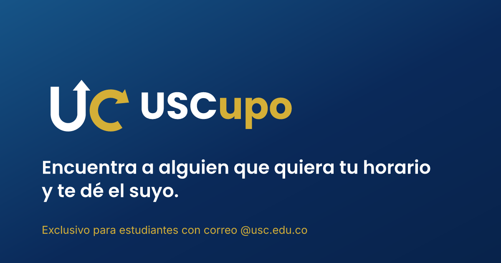

  <picture>
    <source media="(prefers-color-scheme: dark)" srcset="assets/uscupo-kit/horizontal/uscupo-horizontal-negativo.svg">
    
  </picture>

  <strong>Encuentra a alguien que quiera tu horario y te dé el suyo.</strong> 
  Intercambio de cupos entre estudiantes de la Universidad Santiago de Cali.

  <a href="https://www.uscupo.com"><strong>www.uscupo.com</strong></a> ·
  <a href="https://www.uscupo.com/preguntas">Preguntas frecuentes</a> ·
  <a href="https://www.uscupo.com/acerca">Acerca de</a>

  

---

## El problema

Cada semestre a muchos estudiantes les queda una materia en un horario que no les sirve: choca
con el trabajo, con otra clase o con el transporte. Muchas veces alguien de la misma carrera tiene
justo el grupo que necesitan y quiere el suyo, pero no hay una forma sencilla de encontrarse.

## Qué hace USCupo

USCupo junta a esos dos estudiantes. Publicas el grupo que tienes y los horarios que te sirven, y
la app te muestra a quien tiene lo que buscas y, además, busca lo que tú tienes.

1. **Publicas tu cupo**: materia, grupo, el horario que tienes y los que buscas.
2. **Encuentras tu cambio**: primero ves las coincidencias exactas; si no hay, todas las ofertas
   de tu carrera, filtradas por materia y por día.
3. **Se contactan**: cuando alguien marca interés, los dos ven el contacto del otro durante
   7 días.
4. **Hacen el cambio** por los canales oficiales de la USC y lo confirman en la app.

## Lo que lo hace confiable

- **Solo estudiantes de la USC.** Para entrar hace falta un correo `@usc.edu.co` confirmado, con
  tu cuenta de Microsoft de la Universidad o con contraseña.
- **Tu contacto, solo cuando hace falta.** Tu correo o tu WhatsApp aparecen únicamente para el
  estudiante con quien vas a cambiar, y tú eliges cuál mostrar.
- **Moderación.** Cualquier oferta se puede reportar y cualquier estudiante se puede bloquear;
  el bloqueo es mutuo e invisible.
- **Tus datos, bajo tu control.** Política de privacidad conforme a la Ley 1581 de 2012 de
  Colombia, autorización expresa al registrarte y eliminación de la cuenta en cualquier momento.
- **Gratis.** No se cobra por publicar ni por contactar. El proyecto se sostiene con anuncios.

## Plataformas

| | Estado |
| --- | --- |
| **Web** | Disponible en [www.uscupo.com](https://www.uscupo.com), en el computador y el celular |
| **Android** | En desarrollo, nativa (Kotlin y Jetpack Compose) |
| **iOS** | En diseño, nativa (Swift y SwiftUI) |

Las tres comparten el mismo backend, las mismas reglas y la misma identidad visual: el azul y el
amarillo de la USC sobre superficies de cristal translúcidas.

## Cómo está hecho

- **Web**: Expo Router y React Native Web, con páginas prerenderizadas para que carguen rápido y
  las lean buscadores y asistentes de IA (cada página pública también responde en Markdown).
- **Backend**: Supabase, con Postgres, autenticación y reglas de acceso por fila (RLS). Las
  acciones sensibles (marcar interés, revelar el contacto, confirmar o liberar un cambio,
  reportar, bloquear) pasan por funciones del servidor; el cliente nunca decide el estado de una
  oferta.
- **Hosting**: Vercel, con cabeceras de seguridad estrictas (CSP, HSTS) y caché de un año para
  los recursos estáticos.
- **Diseño**: modo claro y oscuro, etiquetas para lectores de pantalla y una interfaz adaptada a
  teléfono, tableta y computador.

## Estado

La web está publicada en [www.uscupo.com](https://www.uscupo.com). Lo próximo:

- Publicar la app de Android en Google Play.
- Activar el ingreso con Microsoft 365 cuando la Universidad apruebe la aplicación.
- Construir la app de iOS.

## Contacto

¿Dudas, ideas o un reporte? Escribe a **uscupo.app@outlook.com** o usa la página de
[contacto](https://www.uscupo.com/contacto).

Creado y mantenido por **Gustavo Andrés Cerón Galeano**, en Cali.

## Licencia

© 2026 Gustavo Andrés Cerón Galeano. Todos los derechos reservados. El código es público solo
para consulta; copiarlo, modificarlo o usarlo requiere autorización por escrito. Ver
[LICENSE](LICENSE).

---

USCupo es un proyecto independiente de estudiantes y no es una app oficial de la
Universidad Santiago de Cali. Las inscripciones y los cambios de grupo se hacen por los canales
oficiales de la Universidad.
